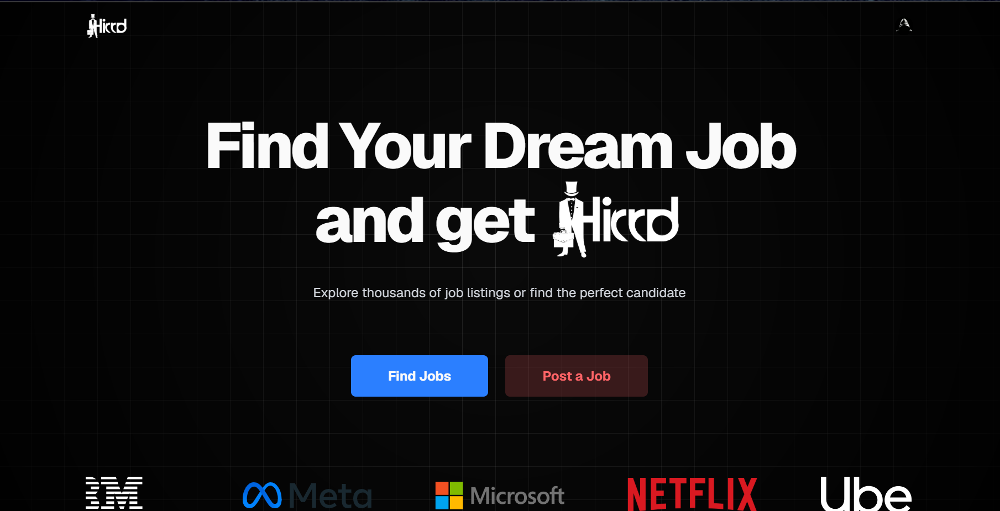
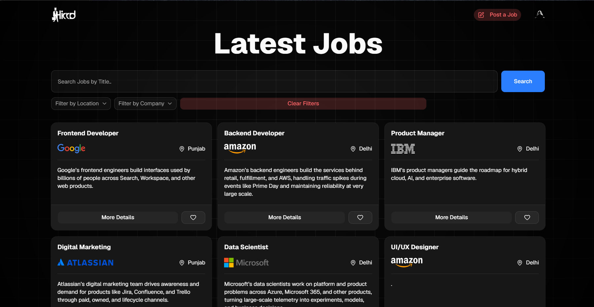
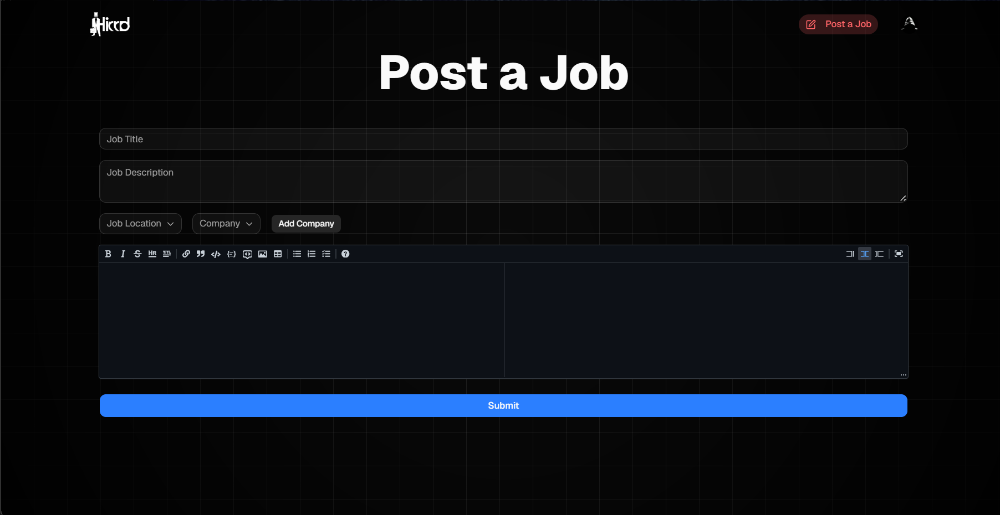

# Hirrd – Full-Stack Job Portal

A modern job portal web application that connects candidates with recruiters. The platform allows candidates to explore job opportunities and recruiters to manage job postings and applications.

## 🚀 Features

- Separate candidate and recruiter roles
- User authentication and onboarding
- Job posting and management
- Job application functionality
- Saved jobs
- Search and filtering by role, company, and location
- Database integration for jobs and applications

## 🛠️ Technologies Used

- React
- Tailwind CSS
- shadcn/ui
- Supabase
- Clerk

## 📸 Screenshots

### Homepage

### Job Listings

### Dashboard

## 🌐 Live Demo

[View Live Project](https://hirrd-navy.vercel.app/)

## 👨‍💻 Author

**Syed Taha Bukhari**

- GitHub: [Taha-bukhari](https://github.com/Taha-bukhari)
- LinkedIn: [My LinkedIn Profile](https://linkedin.com/in/tahabukhari-a512702a8)
- Email: tahabukhari175@gmail.com
